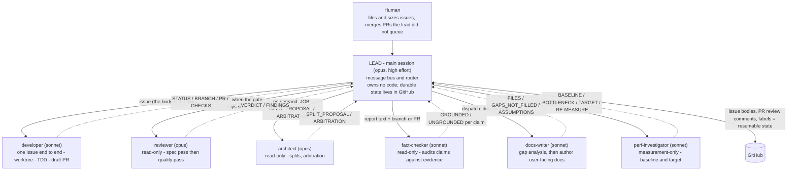
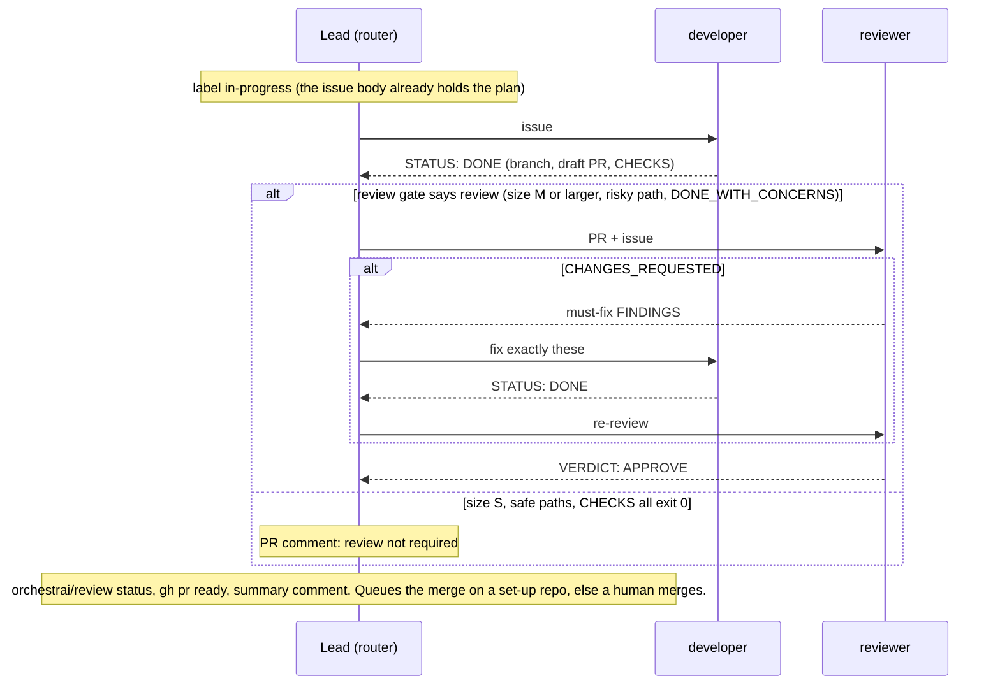

# Agent team architecture

How the orchestrator team actually runs. The operating rules live in
`.claude/team-guide.md` and the neutral core, `.claude/process-core.md`;
this doc adds the picture. The flow itself (review gate, merge gate, resume)
is `docs/architecture/light-flow.md`; the per-package mechanics (parking,
caps, routing) live in `.claude/skills/tm-kickoff/SKILL.md`.

"Agent team" is this template's name for the flat-star pattern below, not
Claude Code's experimental agent-teams feature (enabled with
`CLAUDE_CODE_EXPERIMENTAL_AGENT_TEAMS`), where separate full sessions
coordinate peer-to-peer. Ours is built from subagents and dynamic workflows:
the lead spawns role agents that report back to it and never call each other.

## Flat star, not a nested tree

Claude Code now lets a subagent spawn its own subagents (a nested tree; the
tutorial this doc draws on reports a fixed depth cap, which we have not measured
here). We deliberately do not nest. The lead session is the only spawner and
routes every handoff. The reviewer and the architect are read-only by tool
restriction; the developer and the docs-writer write, but every role agent is
held to the same no-spawn rule, so the star is structural, not just convention.

The reason is resumability. A nested tree lives and dies inside one session, so
a dropped connection loses the in-flight sub-tree. Our handoffs go through the
lead and land as GitHub artifacts (the issue body, PR review comments,
labels), so a dropped session resumes from GitHub instead of restarting. We keep
the separation a nested model gives (one concern per agent, evidence flows up,
independent review, draft PR with a queued or human merge) without trading away
resumability. Parallelism comes from worktree isolation, not nesting.

Peers under one lead, no third level. Evidence flows back to the lead, which
routes it into the next agent. GitHub holds the state that makes a dropped
session resumable. The `architect`, `fact-checker`, `docs-writer`, and
`perf-investigator` sit outside the per-package flow. The lead asks the
`architect` on demand, to split an `L` issue or settle a developer and
reviewer dispute. It dispatches `fact-checker` on
demand when a report's claims are load-bearing but carry no evidence, and
routes any CONTRADICTED claim back to the agent that made it; it dispatches
`docs-writer` on demand, for example after a `tm-map-codebase` run, when
user-facing docs are missing or stale; and it dispatches `perf-investigator`
on demand when a package's job is specifically a performance investigation,
handing its baseline to the developer before implementation and its
re-measure commands to the reviewer afterward.

## The per-package flow

For one issue, the lead runs the developer, then a reviewer only when the
review gate says so, and loops on a change request. This is the happy path
with the one fix loop. It omits parking (`needs-human`), `NEEDS_CONTEXT`,
the 2-round fix cap, the red-checks round for a gate-skipped package, and the
conflict rule, all of which live in `docs/architecture/light-flow.md` and
`.claude/skills/tm-kickoff/SKILL.md`.

Up to three packages run this flow at once, in isolated worktrees. The lead
never edits code; it routes reports and decides escalations.

---

Source: drawn from a tutorial on nested subagents in Claude Code
(owainlewis/youtube-tutorials), adapted to our flat-star model.
